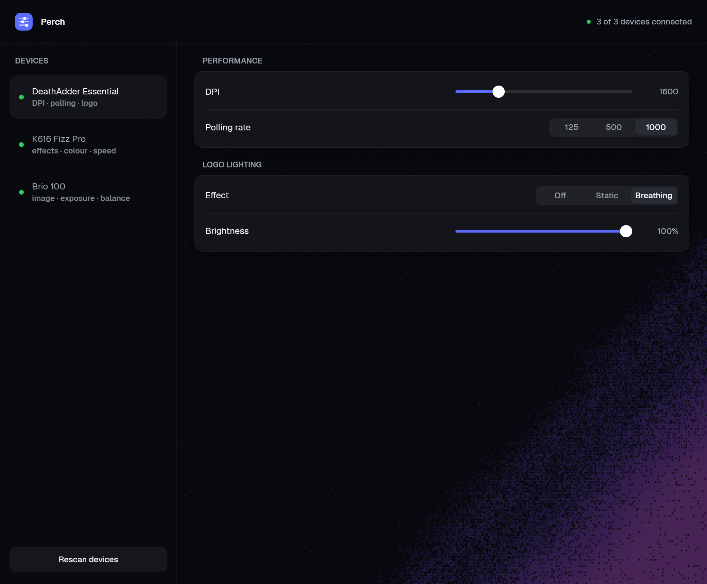
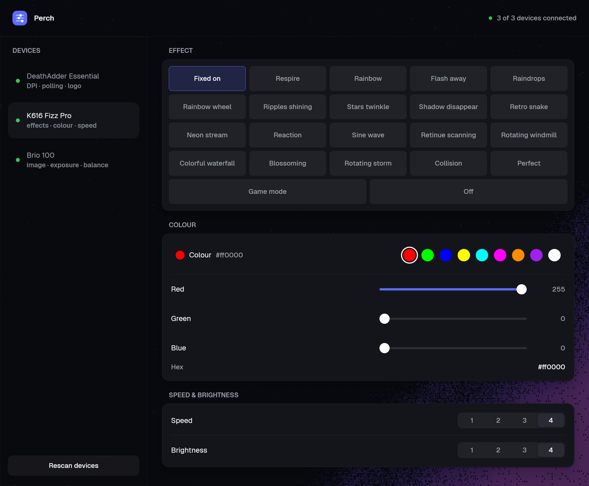
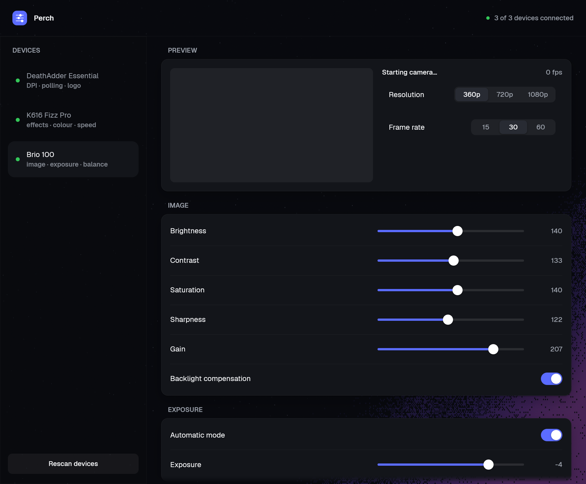

# perch

One settings window for three peripherals on Windows. Rust, no Synapse, no
vendor control panels running in the background.

| Device | USB | Controls |
|---|---|---|
| Razer DeathAdder Essential (2021) | `1532:0098` | DPI (200–6400, 100 steps), polling (125/250/500/1000 Hz), white logo (off/static/breathing), brightness |
| Redragon K616 Fizz Pro (wired) | `258A:0049` | all 20 firmware modes + game/off, full RGB colour, speed and brightness 1–4 |
| Logitech Brio 100 | `046D:094C` | live preview at 360p/720p/1080p and 15/30/60 fps (measured rate shown), brightness, contrast, saturation, sharpness, gain, backlight compensation, exposure (auto/manual), white balance (auto/manual, 2800–7500 K) |

Everything was verified against the hardware on this machine: mouse values are
read back after every write, camera values come back from DirectShow, and the
keyboard's four 1032-byte feature reports were confirmed with a visible effect.

## Build, install, run

```powershell
cargo build --release --workspace
./scripts/install.ps1        # copies the two exes, adds the Start Menu entry and the `perch` command
```

Then: Start menu → **Perch**, or `perch list` in any terminal. The installer
is per-user (`%LOCALAPPDATA%\Programs\perch`), needs no admin, and is safe to
re-run after a rebuild. To remove it, delete that folder, the `Perch`
shortcut and `%LOCALAPPDATA%\Microsoft\WindowsApps\perch.cmd`.

The UI needs Rune, which is pre-release and expects its vendored dependency
patches. `vendor/rune` is a sparse checkout of the pinned `dev` rev; the
workspace `[patch.crates-io]` points into it. Create it once with:

```powershell
./scripts/setup-rune.ps1
```

## CLI

```
perch list
perch probe          # HID collections, usages and feature-report sizes
perch mouse status
perch mouse dpi 1600
perch mouse polling 500
perch mouse brightness 80
perch mouse color "#ff0000"
perch mouse effect breathing:"#00ff00"

perch keyboard effects
perch keyboard effect rainbow --speed 2 --brightness 3
perch keyboard color "#ff0000"

perch camera status
perch camera grab frame.ppm     # one 640x360 frame, P6 PPM
perch camera set brightness 160
perch camera auto exposure off
```

## Layout

```
crates/perch-core/
  hid.rs        SetupAPI enumeration + HidD feature reports (no hidapi, no C)
  razer.rs      90-byte Razer reports: DPI, polling, extended-matrix lighting
  redragon.rs   captured 1032-byte firmware-effect bursts, colour at block 1[29..31]
  camera.rs     DirectShow IAMVideoProcAmp / IAMCameraControl
crates/perch-cli/   `perch`
crates/perch-app/   Rune window (sidebar + per-device panels)
docs/                rendered panels
```

Protocol notes that matter:

- Razer writes need the leading report-id byte (91 bytes on Windows) and
  `transaction_id = 0x1f`; colour and brightness use class `0x0f`, not the older
  `0x03` chroma class.
- The K616 shares the K617 protocol. The 6-byte report-5 handshake in the
  captures is rejected by Windows on this device and is unnecessary: the four
  1032-byte blocks alone change the lighting.
- Brio 100 has no focus, zoom, HDR or field-of-view controls. Only the eight
  UVC selectors above exist in hardware.
- The K616's mode IDs match the vendor list 1:1 (Fixed_on=0x01 … Perfect=0x14,
  Game mode=0x15, Off=0x00); the template is only a carrier for the mode byte.
- Speed/brightness are the 20 two-byte pairs at block 4 offsets 38..77
  (`speed << 4 | brightness`), not two bytes. See `docs/keyboard-protocol.md`.
- The K616 has no read path (its feature reports reject `GET_FEATURE`), so the
  keyboard panel starts at Static/red instead of reading the current effect.

## Credits

- Backdrop: generated procedurally by `scripts/backdrop.py` (nightfall variant).
- Type: [Geist](https://github.com/vercel/geist-font) (OFL).
- Effect templates and protocol notes: see `THIRD_PARTY.md`.

- Razer command encodings: OpenRazer (GPL) protocol notes and
  [freenapse](https://github.com/MatthewSaintBull/freenapse) (MIT) for the
  Windows HID framing.
- Redragon effect templates: [fizz-rgb](https://github.com/MrSchrodingers/fizz-rgb) (MIT).
- UVC control model: DirectShow; [OpenLogi](https://github.com/AprilNEA/OpenLogi)
  (Apache-2.0/MIT) covers the same ground if you want an existing camera panel.




